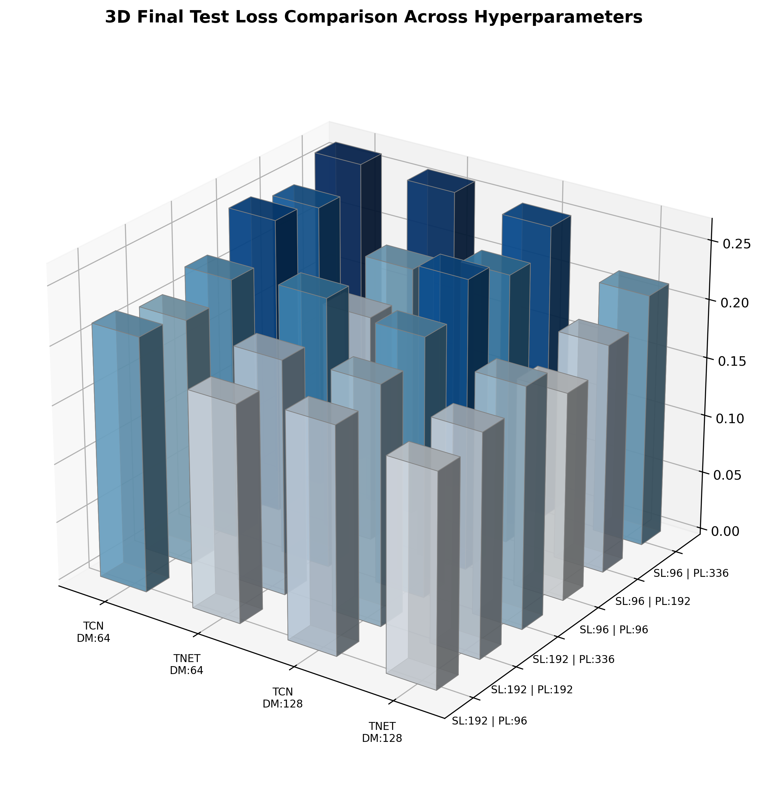

# Multivariate Time Series Forecasting: TimesNet vs TCN

## Overview

This project explores deep learning approaches for long-term multivariate time series forecasting. I implemented and compared two different neural network architectures: **TimesNet**, which exploits multi-periodic patterns through FFT-based decomposition and 2D representations, and a **Temporal Convolutional Network (TCN)**, used as a convolutional baseline.

The experiments are conducted on the Electricity dataset, a widely used benchmark containing hourly electricity consumption measurements from 321 clients.

The main objective is to investigate how different approaches to temporal modeling affect forecasting accuracy, and to evaluate the influence of key architectural and training hyperparameters.

## Models

Two architectures are implemented in PyTorch:

- **TimesNet:** identifies dominant frequencies using the Fast Fourier Transform (FFT), reshapes time series into multiple 2D representations, and processes them using Inception-style convolutional blocks. This allows the model to capture both intra-period and inter-period temporal variations.
- **Temporal Convolutional Network (TCN):** uses causal dilated 1D convolutions and residual connections to capture temporal dependencies over different time scales.

Both models share a similar input/output structure and embedding dimension, allowing for a more consistent comparison.

## Experimental Setup

I investigate the effect of different configurations by varying the following hyperparameters:

| Parameter | Values |
|:---|:---|
| Input sequence length ($L$) | 96, 192 |
| Prediction horizon ($H$) | 96, 192, 336 |
| Embedding dimension ($d_{model}$) | 64, 128 |
| Number of dominant frequencies ($k$) | 1, 3, 5, 7 |

The experiments include comparisons of training and validation losses, test forecasting errors, and individual prediction examples. I also investigate the effect of the number of selected frequencies on TimesNet's accuracy and computational cost.

## Results



The experiments show that TimesNet generally achieves lower forecasting errors than the TCN baseline across the tested configurations.

The results highlight the advantages of explicitly modeling periodic structures through 2D representations, particularly for datasets with recurring temporal patterns. Increasing the number of selected frequencies further improves forecasting accuracy, although at the cost of increased computational time.

The project also provides a comparison of the two architectures in terms of predictive performance and computational efficiency.

## Technologies

- Python
- PyTorch
- NumPy
- Pandas
- Matplotlib
- Fast Fourier Transform (FFT)
- Convolutional Neural Networks

## References

The project is based on the following research works:

- Wu et al., *TimesNet: Temporal 2D-Variation Modeling for General Time Series Analysis*, ICLR 2023. https://github.com/thuml/Time-Series-Library
- Bai et al., *An Empirical Evaluation of Generic Convolutional and Recurrent Networks for Sequence Modeling*, 2018.

This project was developed as part of the Neural Networks and Deep Learning course at the University of Padova.

## Running Experiments

Experiments are launched through `run.py`. The script supports both TimesNet and TCN and allows you to train and evaluate models, generate sample predictions, and extract additional analyses.

### Train and test a model

To train a TimesNet model using the default configuration and then evaluate it on the test set:

```bash
python run.py --train --test
```

To use the TCN baseline instead:

```bash
python run.py --train --test --model TCN
```

### Configure an experiment

The main parameters can be specified through command-line arguments:

| Argument | Description | Default |
|---|---|---:|
| `--model` | Model architecture (`TimesNet` or `TCN`) | `TimesNet` |
| `--seq_len` | Input sequence length | 96 |
| `--pred_len` | Prediction horizon | 96 |
| `--d_model` | Hidden dimension | 64 |
| `--e_layers` | Number of model layers | 2 |
| `--top_k` | Number of dominant periods used by TimesNet | 5 |
| `--batch_size` | Training batch size | 32 |
| `--learning_rate` | Initial learning rate | 0.0001 |
| `--train_epochs` | Maximum number of training epochs | 10 |

For example, to train TimesNet with an input length of 192, a prediction horizon of 336, and a hidden dimension of 128:

```bash
python run.py --train --test --seq_len 192 --pred_len 336 --d_model 128
```

### Additional analysis

The script also provides options for inspecting model predictions and periodicity:

```bash
# Generate predictions for a sample batch
python run.py --predict_samples

# Extract 2D representations from TimesNet
python run.py --extract

# Compute the multi-periodicity histogram
python run.py --periods_hist
```

These analysis options use the corresponding experiment configuration and load the best available checkpoint. Therefore, train the model first if the required checkpoint does not already exist.

Checkpoints are saved in `./checkpoints/` by default. The dataset location can be changed using `--root_path` and `--data_path`.
